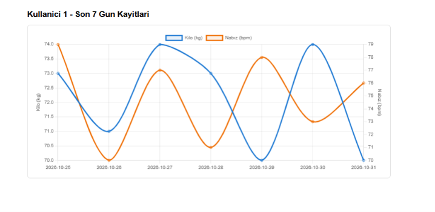
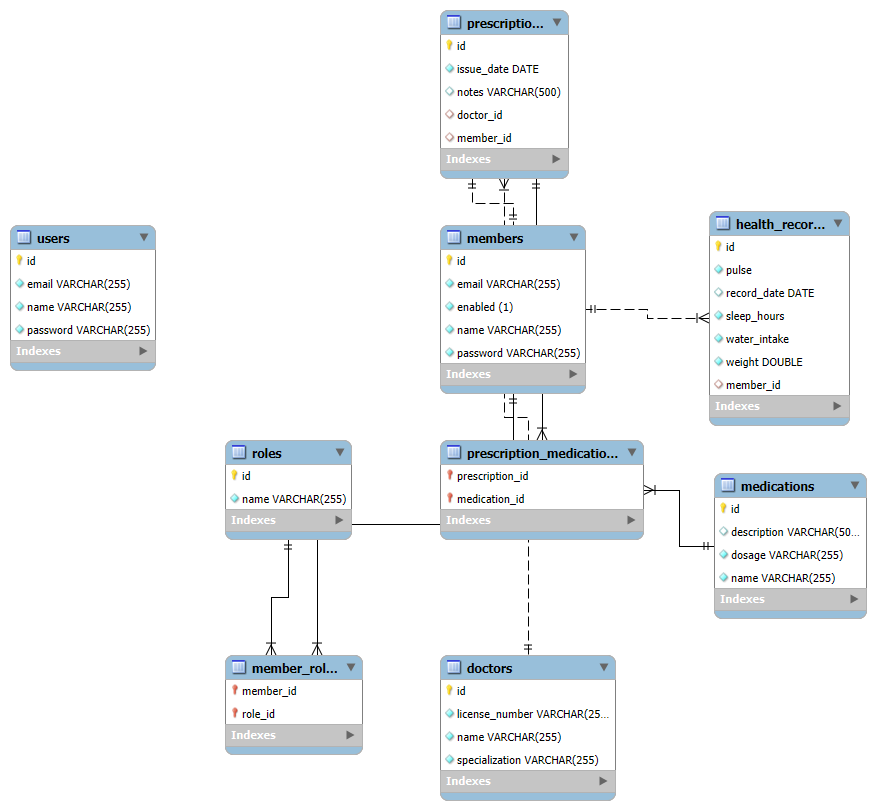

# 🏥 MedTrack – Web-Based Health Tracking & Medical Management System

[](https://spring.io/projects/spring-boot)
[](https://www.oracle.com/java/)
[](https://www.mysql.com/)
[](https://spring.io/projects/spring-security)
[](https://www.docker.com/)

MedTrack is a health tracking platform and RESTful service built with **Spring Boot 3** and **Java 21**. It allows patients, doctors, and administrators to record, review, and visualize vital metrics, health records, and prescriptions, with role-based access rules enforced by Spring Security.

---

## 📸 Preview

### Interactive Health Metric Dashboard
Weekly vitals (weight, pulse, sleep, hydration) are visualized with Chart.js. The chart below is rendered from generated sample data:
<p align="center">
  
</p>

### Database EER Diagram
Generated with MySQL Workbench (reverse engineering) from the JPA-managed schema:
<p align="center">
  
</p>

> **Note:** The `users` table is a standalone CRUD entity exposed under `/users` and is not part of authentication. Login is resolved through the `members` and `roles` tables.

---

## ✨ Key Features

- **Role-Based Access Control:** `ADMIN`, `DOCTOR`, and `PATIENT` roles with per-endpoint, per-HTTP-method rules defined in `SecurityConfig`. HTTP Basic authentication with BCrypt-hashed passwords.
- **Vitals Dashboard:** Thymeleaf-rendered dashboard with Chart.js charts of the last 7 days of health records.
- **Explicit Persistence Layer:** Data access is implemented with `EntityManager` and `TypedQuery` rather than Spring Data repositories, giving direct control over queries, transaction boundaries, and fetch strategies.
- **Relational Domain Model covering core JPA relationship types:**
  - `@OneToOne` (Prescription ↔ Member)
  - `@ManyToOne` (Prescription → Doctor, HealthRecord → Member)
  - `@OneToMany` (Member → HealthRecords)
  - `@ManyToMany` (Prescription ↔ Medication, Member ↔ Role)
- **Centralized Exception Handling:** `@ControllerAdvice` for consistent JSON error responses.
- **Health & Info Endpoints:** Spring Boot Actuator (`/actuator/health`, `/actuator/info`).
- **Containerized Setup:** Multi-stage `Dockerfile` (Maven build → Temurin 21 JRE runtime) and `docker-compose.yml` that starts the application together with MySQL 8.4.

---

## 🛠️ Tech Stack

| Layer | Technologies |
|---|---|
| **Language & Runtime** | Java 21 (Eclipse Temurin) |
| **Framework** | Spring Boot 3.5.7 (Web, Security, Validation, Actuator, Thymeleaf, DevTools) |
| **Persistence** | Hibernate ORM, JPA 3.1, HikariCP |
| **Database** | MySQL 8.0+ (MySQL 8.4 in Docker) |
| **Frontend** | Thymeleaf, HTML/CSS, Chart.js |
| **DevOps** | Docker, Docker Compose |
| **Testing & Tooling** | Spring Boot Test, Spring Security Test, Postman collection |

---

## 🔐 Security & Access Control

Access rules are defined per resource and HTTP method:

| Resource | GET | POST / PUT / PATCH | DELETE |
|---|:---:|:---:|:---:|
| `/members/**` | All roles | ADMIN, DOCTOR | ADMIN |
| `/doctors/**` | All roles | ADMIN | ADMIN |
| `/medications/**` | All roles | ADMIN, DOCTOR | ADMIN |
| `/prescriptions/**` | All roles | ADMIN, DOCTOR | ADMIN |
| `/records/**` | All roles | All roles | ADMIN, DOCTOR |
| `/roles/**`, `/users/**` | All roles | ADMIN | ADMIN |
| `/dashboard/{id}` | All roles | — | — |
| `/admin/**` | ADMIN | — | — |
| `/patient/**` | ADMIN, PATIENT | — | — |
| `/actuator/health`, `/actuator/info` | Public | — | — |

A detailed per-endpoint matrix is available in [`medtrack/docs/SECURITY_ENDPOINTS.md`](medtrack/docs/SECURITY_ENDPOINTS.md).

### Seeded Development Accounts

| Username / Email | Password | Role(s) |
|---|---|---|
| `user` | `password` | `ADMIN`, `DOCTOR`, `PATIENT` |
| `admin@medtrack.com` | `admin123` | `ADMIN` |
| `doctor@medtrack.com` | `doctor123` | `DOCTOR` |
| `patient@medtrack.com` | `patient123` | `PATIENT` |

> *These accounts and the database credentials in `docker-compose.yml` are intended for local development only.*

---

## 🧭 Current Scope & Roadmap

The current release focuses on the domain model, the REST API, and endpoint-level role authorization. The following items are planned next:

| Area | Current behavior | Planned improvement |
|---|---|---|
| **Data-level authorization** | Authorization is role-based; any authenticated role with read access can query all members, health records, and prescriptions, and open any member's dashboard. PATIENT can create and update health records for any member. | Ownership checks so that patients only access their own data. |
| **API response shape** | Entities are serialized directly; `GET /members` and `GET /users` include the password field (BCrypt hash). | DTO layer, with passwords excluded from all responses. |
| **Authentication** | HTTP Basic, CSRF disabled (suited to API clients and testing). | Token-based authentication (JWT) and CSRF handling for browser sessions. |
| **Configuration** | `ddl-auto=update`; `/actuator/health` shows component details publicly; development credentials in `docker-compose.yml`. | Profile-based configuration, schema migrations (Flyway/Liquibase), externalized secrets. |
| **Data model** | Prescription ↔ Member is `@OneToOne` (unique foreign key), i.e. one prescription per member. | Many prescriptions per member (`@ManyToOne`). |
| **API documentation** | Postman collection and Markdown docs under `docs/`. | OpenAPI / Swagger UI integration. |
| **Automation** | Basic default Spring context test. | Automated integration tests and a CI workflow (GitHub Actions with Maven). |

> `POST /records/seed/{memberId}` is a helper endpoint that generates sample health records for a member.

---

## 🚀 Getting Started

### Prerequisites
- **Java 21 JDK**
- **Maven** (or the included `./mvnw` wrapper)
- **MySQL 8+** or **Docker Desktop**

---

### Option 1: Run with Docker (Recommended)

```bash
cd medtrack
docker compose up --build
```
The application is available at **`http://localhost:9090`**. The MySQL container is published on host port `3308`.

---

### Option 2: Run Locally with Maven

1. **Create the database:**
   ```sql
   CREATE DATABASE medtrack;
   ```

2. **Set your credentials and start the application:**

   **Windows (PowerShell):**
   ```powershell
   cd medtrack
   $env:SPRING_DATASOURCE_PASSWORD="your_mysql_password"
   .\mvnw.cmd spring-boot:run
   ```

   **Linux / macOS (Bash):**
   ```bash
   cd medtrack
   export SPRING_DATASOURCE_PASSWORD="your_mysql_password"
   ./mvnw spring-boot:run
   ```

The application starts on port **`9090`**.

### Configuration

| Environment variable | Default |
|---|---|
| `SPRING_DATASOURCE_URL` | `jdbc:mysql://localhost:3306/medtrack?useSSL=false&allowPublicKeyRetrieval=true&serverTimezone=UTC` |
| `SPRING_DATASOURCE_USERNAME` | `root` |
| `SPRING_DATASOURCE_PASSWORD` | *(empty)* |

---

## 🧪 Testing the API

### 1. Health check (Public)
```bash
curl http://localhost:9090/actuator/health
```

### 2. Fetch health records (Authenticated)
```bash
curl -u user:password http://localhost:9090/records
```

**Example response:**
```json
[
  {
    "id": 1,
    "weight": 70.0,
    "pulse": 77,
    "waterIntake": 7,
    "sleepHours": 7,
    "recordDate": "2026-10-31"
  }
]
```

> **Windows PowerShell note:** `curl` is an alias for `Invoke-WebRequest`. Use `curl.exe`, or `Invoke-RestMethod` with an `Authorization: Basic ...` header.

### 3. Dashboard
Open **`http://localhost:9090/dashboard/1`** in a browser and sign in with `user` / `password`.

### 4. Postman Collection
A collection covering all API endpoints is available at:
📁 [`medtrack/postman/MedTrack.postman_collection.json`](medtrack/postman/MedTrack.postman_collection.json)

---

## 📁 Project Structure

```text
medtrack/
├── docs/                                # Documentation & diagrams
│   ├── dashboard-preview.png            # Dashboard screenshot
│   ├── medtrack-eer-diagram.png         # Database EER diagram
│   ├── RELATIONSHIPS.md                 # Owning/inverse side of each JPA relationship
│   └── SECURITY_ENDPOINTS.md            # Endpoint and role access matrix
├── postman/
│   └── MedTrack.postman_collection.json # API testing collection
├── Dockerfile                           # Multi-stage build
├── docker-compose.yml                   # Application + MySQL 8.4
└── src/main/java/tr/edu/gumushane/medtrack/
    ├── config/                          # Security, JPA & data initializer config
    ├── controller/                      # REST and MVC (Thymeleaf) controllers
    ├── entity/                          # JPA entities
    ├── exception/                       # Global exception handling
    ├── repository/                      # EntityManager-based repositories
    └── service/                         # Business logic
```

---

## 👥 Contributors

- **Eda Akkuş** - [@edaakkus](https://github.com/edaakkus)
- **Dilay Deveci**

---

## 🎓 Background

MedTrack was developed at **Gümüşhane University** as part of a software architecture and database design course, with a focus on JPA relationship mapping, layered REST design, and role-based security with Spring Security.
